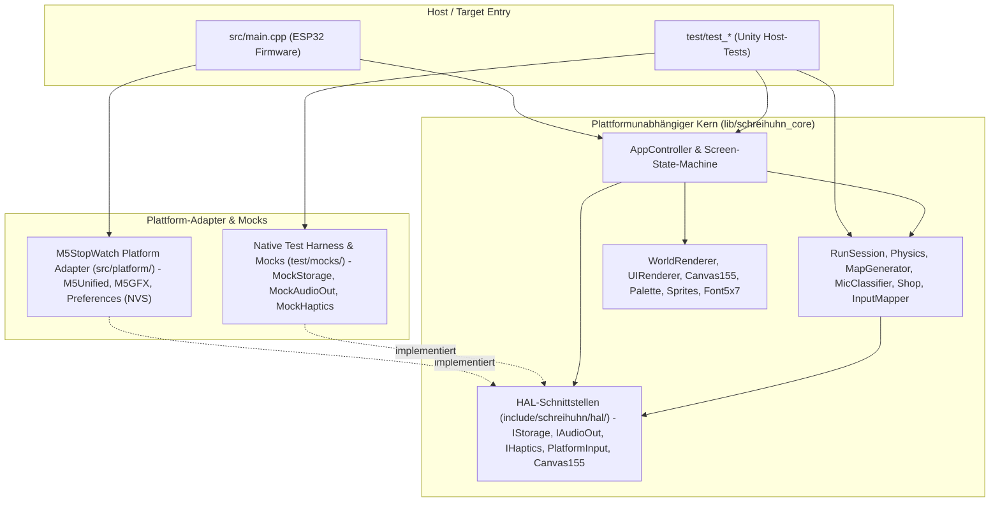

# 01 – Systemkontext & Schichten

## 1.1 Schichtenmodell & Abhängigkeitsrichtung

Alle Abhängigkeiten zeigen **von außen nach innen** bzw. gegen abstrakte Schnittstellen in
`lib/schreihuhn_core/include/schreihuhn/hal/`. Der Core kennt weder `Arduino.h`, `M5Unified.h`,
`M5GFX.h`, `Preferences.h` noch ESP-IDF-APIs.



### Schichten-Verantwortlichkeiten

| Schicht | Verantwortlichkeit | Erlaubte Abhängigkeiten |
|---------|-------------------|------------------------|
| **Core (`lib/schreihuhn_core`)** | Tuning-Konstanten, Typen, Audio-Klassifizierung, Physik, Map-Generator, Shop/Persistenz-Logik, Input-Logik, Paletten-Rendering, App-Steuerung | C++17-Standardbibliothek (`<cstdint>`, `<cmath>`, `<algorithm>`, `<array>`, `<cstring>`); keine Heap-Allokationen im Frame-Loop |
| **HAL-Interfaces (`hal/`)** | Schlanke abstrakte Interfaces (`IStorage`, `IAudioOut`, `IHaptics`) und reine Datentransfer-Typen (`PlatformInput`, `Canvas155`) | Nur Core-Basistypen |
| **Platform Adapter (`src/platform/`)** | Anbindung von `M5Unified` (Display, Touch, Tasten, Mikrofon, Lautsprecher, Vibration), `M5PM1`/`M5IOE1` (falls direkt nötig), ESP32 `Preferences` (NVS) | Core + HAL + Arduino/M5Stack-Bibliotheken |
| **Test Harness (`test/`)** | Deterministische Unit-, Integrations- und Fuzz-Tests für `AT-02`–`AT-21` | Core + HAL + `MockHAL` + `Unity` |

---

## 1.2 Verzeichnisstruktur des Repositorys

```text
M5StopWatch/
├── AGENTS.md
├── README.md                              (vom Implementierer anzulegen, DoD 11.3)
├── TESTING.md                             (vom Implementierer anzulegen, DoD 11.3)
├── platformio.ini                         (Build- & Test-Konfiguration)
├── spec/                                  (Fachliche Spezifikation 01..13)
├── docs/                                  (Architektur-Spezifikation 01..05)
├── lib/
│   └── schreihuhn_core/                   (Plattformunabhängiger C++17-Kern)
│       ├── library.json                   (PlatformIO Library-Manifest)
│       ├── include/
│       │   └── schreihuhn/
│       │       ├── config/
│       │       │   └── tuning.h           (ALLE K_*-Konstanten zentral)
│       │       ├── core/
│       │       │   ├── math_types.h       (Vec2, Rect, XorShift32 PRNG)
│       │       │   └── ring_buffer.h      (StaticRingBuffer<T, N>)
│       │       ├── hal/
│       │       │   ├── i_storage.h        (Persistenz-Interface)
│       │       │   ├── i_audio_out.h      (Sound-Trigger & Gating-Callback)
│       │       │   ├── i_haptics.h        (Vibrations-Interface)
│       │       │   ├── platform_input.h   (Roh-Input-Struct pro Frame)
│       │       │   └── canvas155.h        (155x155 8-Bit-Paletten-Canvas)
│       │       ├── audio/
│       │       │   ├── mic_classifier.h   (RMS, dBFS, Kalibrierung, EMA, Gating, Hysterese)
│       │       │   └── sound_catalog.h    (Noten-/Tonfolgen SND-START..SND-TOGGLE)
│       │       ├── world/
│       │       │   ├── world_types.h      (Island, BridgeSegment, Obstacle, Coin, ChunkType)
│       │       │   ├── solvability.h      (Referenzsimulation für FR-MP-36)
│       │       │   └── map_generator.h    (Deterministischer Chunk-Generator)
│       │       ├── game/
│       │       │   ├── player.h           (PlayerState, Hitbox, AnimationState)
│       │       │   ├── physics.h          (Bewegung, AABB-Kollision, Anti-Tunneling)
│       │       │   └── run_session.h      (Laufender Run: Welt + Spieler + Kamera + Score + Brücken)
│       │       ├── persistence/
│       │       │   ├── save_data.h        (SaveData Struct, Validierung/Sanitizing)
│       │       │   └── shop_logic.h       (Huhn-Auswahl, Kauf-Transaktion)
│       │       ├── input/
│       │       │   └── input_mapper.h     (Kurz-/Langdruck, Tap, Screen-Lockout)
│       │       ├── render/
│       │       │   ├── palette.h          (PICO-8 Farben RGB888 & RGB565)
│       │       │   ├── sprites.h          (Code-Arrays: Hühner, Coins, Tiles, Icons)
│       │       │   ├── font5x7.h          (Pixel-Font inkl. Umlaute ÄÖÜ & Symbole)
│       │       │   ├── world_renderer.h   (Himmel, Parallax, Inseln, Brücken, Hindernisse, Huhn)
│       │       │   └── ui_renderer.h      (Screens S1..S7, HUD, Safe-Circle)
│       │       └── app/
│       │           └── app_controller.h   (Screen-State-Machine & Haupt-Tick)
│       └── src/
│           └── (*.cpp-Implementierungen zu den Headern)
├── src/                                   (Nur ESP32-Firmware-Einstieg & Hardware-Adapter)
│   ├── main.cpp                           (setup(), loop(), Debug-Log-Ausgabe)
│   └── platform/
│       ├── m5_display_adapter.h/.cpp      (3x Upscaling 155->465 in PSRAM + pushSprite)
│       ├── m5_audio_adapter.h/.cpp        (M5.Mic Puffer-Lesen, M5.Speaker Sequenzer, Gating)
│       ├── m5_input_adapter.h/.cpp        (M5.BtnA/BtnB, M5.Touch, SIM_INPUT-Override)
│       ├── m5_storage_adapter.h/.cpp      (ESP32 Preferences "schreihuhn")
│       └── m5_haptics_adapter.h/.cpp      (M5.Power.setVibration mit Ablauf-Timer)
└── test/                                  (Automatisierte Host-Unit-Tests für pio test -e native)
    ├── mocks/
    │   └── mock_hal.h                     (MockStorage, MockAudioOut, MockHaptics)
    ├── test_mic_classifier/
    │   └── test_main.cpp                  (AT-02, AT-03, AT-04, AT-05)
    ├── test_physics_and_bridge/
    │   └── test_main.cpp                  (AT-06, AT-07, AT-08, AT-09, AT-10, AT-11, AT-12)
    ├── test_map_generator/
    │   └── test_main.cpp                  (AT-13, AT-14, AT-15)
    └── test_app_flow_and_shop/
        └── test_main.cpp                  (AT-16, AT-17, AT-18, AT-19, AT-20, AT-21)
```

> Hinweis für `lib/schreihuhn_core/library.json`: Eine einfache `library.json` mit `"name": "schreihuhn_core"`,
> `"version": "1.0.0"`, `"build": { "flags": ["-std=gnu++17", "-Iinclude"] }` bzw. `"-std=c++17"`
> sorgt dafür, dass PlatformIO den Core automatisch sowohl in `stopwatch` als auch in `native`
> einbindet.

---

## 1.3 Verbindliche `platformio.ini`-Konfiguration

Die folgenden drei Environments müssen in `platformio.ini` definiert werden (`RB-02`, `RB-03`,
`RB-04`, `NFR-10`). Alle `lib_deps` sind mit exakten Versionen bzw. Git-Tags/Commits zu pinnen
(die untenstehenden Tags sind beim Aufsetzen auf Kompatibilität mit StopWatch C152 zu prüfen und
bei Bedarf auf den getesteten Stand in `spec/13` Abschnitt 13.4 zu pinnen):

```ini
[platformio]
default_envs = stopwatch

[env:stopwatch]
platform = espressif32 @ 6.12.0
board = esp32s3box
framework = arduino
board_build.partitions = default_16MB.csv
board_upload.flash_size = 16MB
board_upload.maximum_size = 16777216
board_build.arduino.memory_type = qio_opi
monitor_speed = 115200
build_unflags =
    -std=gnu++11
build_flags =
    -std=gnu++17
    -Wall
    -Wextra
    -DESP32S3
    -DBOARD_HAS_PSRAM
    -DARDUINO_USB_CDC_ON_BOOT=1
    -DARDUINO_USB_MODE=1
    -Ilib/schreihuhn_core/include
lib_deps =
    ; Auf feste Versionen/Commits pinnen (mind. M5Unified >= 0.2.15, M5GFX >= 0.2.21)
    m5stack/M5Unified @ ^0.2.15
    m5stack/M5GFX @ ^0.2.21
    https://github.com/m5stack/M5PM1.git#<PINNED_TAG_OR_COMMIT>
    https://github.com/m5stack/M5IOE1.git#<PINNED_TAG_OR_COMMIT>
test_ignore = *

[env:stopwatch_debug]
extends = env:stopwatch
build_flags =
    ${env:stopwatch.build_flags}
    -DDEBUG_LOG
    -DSIM_INPUT

[env:native]
platform = native
build_flags =
    -std=c++17
    -Wall
    -Wextra
    -Werror=return-type
    -Ilib/schreihuhn_core/include
    -Itest/mocks
lib_deps =
    throwtheswitch/Unity @ ^2.6.0
build_src_filter = -<*>
```

### Wichtige Build- und Include-Regeln für ESP32 (`stopwatch`)

1. **Include-Reihenfolge:** In Dateien unter `src/` muss `#include <M5Unified.h>` **immer vor**
   `#include <M5PM1.h>` und `#include <M5IOE1.h>` stehen, um `i2c_config_t`-Typkonflikte zwischen
   ESP-IDF- und M5-Headern zu vermeiden.
2. **Kein Warnungs-Rauschen im eigenen Code (`NFR-10`):** `-Wall -Wextra` gilt für `src/` und
   `lib/schreihuhn_core/`. Warnungen in externen Bibliotheken unter `.pio/libdeps/` werden
   ignoriert; der eigene Code muss warnungsfrei bauen.
3. **Optionales `RESET_SAVE`-Flag (`FR-SH-06`):** Ein Build mit `-DRESET_SAVE` (entweder via
   `PLATFORMIO_BUILD_FLAGS=-DRESET_SAVE` oder eigenem `[env:stopwatch_reset]`) löscht beim Start
   in `M5StorageAdapter::reset()` den Namespace `schreihuhn` einmalig vor `load()`.
