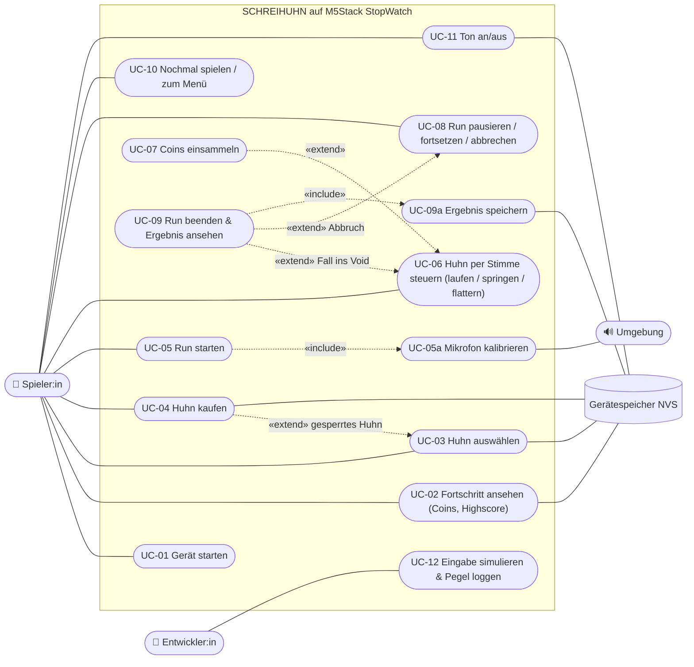

# 04 – Use Cases

## 4.1 Akteure

| Akteur | Typ | Beschreibung |
|--------|-----|--------------|
| **Spieler:in** | Primär, Mensch | Bedient das Gerät per Stimme, Touch und Tasten. |
| **Entwickler:in** | Sekundär, Mensch | Nutzt Debug-Funktionen (nur mit Build-Flags). |
| **Gerätespeicher (NVS)** | Sekundär, System | Hält Coins, Highscore, Freischaltungen, Einstellungen dauerhaft. |
| **Umgebung (Geräuschkulisse)** | Sekundär, extern | Liefert Grundrauschen, das bei der Kalibrierung gemessen wird. |

## 4.2 Use-Case-Diagramm (High Level)

> Hinweis zur Notation: `«include»` = wird immer mit ausgeführt; `«extend»` = optionale/bedingte
> Erweiterung (Pfeile zeigen bei «extend» von der Erweiterung zur Basis, bei «include» von der Basis
> zum eingebundenen UC).

## 4.3 Use-Case-Übersicht

| ID | Name | Akteur | Prio | User Stories |
|----|------|--------|------|--------------|
| UC-01 | Gerät starten | Spieler:in | M | US-01 |
| UC-02 | Fortschritt ansehen | Spieler:in | M | US-02 |
| UC-03 | Huhn auswählen | Spieler:in | M | US-03 |
| UC-04 | Huhn kaufen | Spieler:in | M | US-04 |
| UC-05 | Run starten | Spieler:in | M | US-05, US-07 |
| UC-05a | Mikrofon kalibrieren | System/Umgebung | M | US-07 |
| UC-06 | Huhn per Stimme steuern | Spieler:in | M | US-08–US-15 |
| UC-07 | Coins einsammeln | Spieler:in | M | US-17 |
| UC-08 | Run pausieren / fortsetzen / abbrechen | Spieler:in | M | US-20 |
| UC-09 | Run beenden & Ergebnis ansehen | Spieler:in | M | US-14, US-18 |
| UC-09a | Ergebnis speichern | System/NVS | M | US-18 |
| UC-10 | Nochmal spielen / zum Menü | Spieler:in | M | US-19 |
| UC-11 | Ton an/aus | Spieler:in | S | US-06 |
| UC-12 | Eingabe simulieren & Pegel loggen | Entwickler:in | S | US-23 |

---

## 4.4 Ausformulierte Use Cases

### UC-01 – Gerät starten

| Feld | Inhalt |
|------|--------|
| Ziel | Spieler:in gelangt ins Hauptmenü. |
| Vorbedingung | Gerät ist ausgeschaltet oder wird neu gestartet; Firmware ist geflasht. |
| Auslöser | Einschalten / Reset. |
| Nachbedingung | Hauptmenü wird angezeigt, Speicherstand ist geladen. |

**Hauptszenario**
1. System initialisiert Display, Touch, Tasten, Audio, Speicher.
2. System zeigt den Splash-Screen (Titel + animiertes Huhn), spielt den Start-Jingle (wenn Ton an).
3. System lädt den Speicherstand aus dem NVS.
4. Nach 1,5 s wechselt das System ins Hauptmenü (UC-02).

**Alternativszenarien**
- 2a. Spieler:in tippt / drückt eine Taste → sofort weiter zu Schritt 4 (Laden wird trotzdem abgeschlossen).
- 3a. Kein Speicherstand vorhanden oder beschädigt → Standardwerte (0 Coins, Highscore 0, nur Huhn 1 frei und gewählt, Ton an) werden gesetzt und gespeichert.
- 1a. Mikrofon oder Lautsprecher lässt sich nicht initialisieren → Fehlertext `Mikrofon-Fehler` auf dem Splash, Spiel bleibt im Menü bedienbar; Start eines Runs zeigt erneut den Fehler (kein Absturz).

---

### UC-02 – Fortschritt ansehen

| Feld | Inhalt |
|------|--------|
| Ziel | Spieler:in sieht Coin-Guthaben und Highscore. |
| Vorbedingung | Hauptmenü ist aktiv. |
| Nachbedingung | – (rein lesend) |

**Hauptszenario**
1. System zeigt Coin-Guthaben (oben) und Highscore (unter dem Coin-Guthaben) an.
2. System zeigt das aktuell gewählte Huhn im Auswahlkarussell.

---

### UC-03 – Huhn auswählen

| Feld | Inhalt |
|------|--------|
| Ziel | Spieler:in wählt eines der drei Hühner für den nächsten Run. |
| Vorbedingung | Hauptmenü ist aktiv. |
| Nachbedingung | Angezeigtes Huhn ist im Karussell; wird es gestartet, ist es als gewählt gespeichert. |

**Hauptszenario**
1. Spieler:in tippt auf `◀`/`▶` oder drückt kurz die linke/rechte Taste.
2. System zeigt das vorherige/nächste Huhn (zyklisch: 1→2→3→1) mit Name und Status.
3. Ist das Huhn freigeschaltet, zeigt der Aktions-Button `START` (→ UC-05).
4. Ist das Huhn gesperrt, zeigt der Aktions-Button `KAUFEN <Preis>` bzw. `FEHLEN <n>` (→ UC-04).

**Regel:** Das gespeicherte "gewählte Huhn" ändert sich erst beim Start eines Runs oder nach einem Kauf.

---

### UC-04 – Huhn kaufen

| Feld | Inhalt |
|------|--------|
| Ziel | Spieler:in schaltet ein gesperrtes Huhn mit Coins frei. |
| Vorbedingung | Hauptmenü aktiv, gesperrtes Huhn im Karussell, Guthaben ≥ Preis. |
| Nachbedingung | Guthaben um Preis reduziert, Huhn freigeschaltet und gewählt, gespeichert. |

**Hauptszenario**
1. Spieler:in tippt auf `KAUFEN <Preis>` oder drückt lange die rechte Taste.
2. System zeigt Dialog `Für <Preis> kaufen?` mit `JA` / `NEIN`.
3. Spieler:in bestätigt mit `JA` (Touch oder rechte Taste).
4. System zieht den Preis ab, schaltet das Huhn frei, setzt es als gewählt, speichert sofort.
5. System spielt Kauf-Sound, vibriert kurz, Button wechselt zu `START`.

**Alternativszenarien**
- 1a. Guthaben < Preis → Button ist ausgegraut mit `FEHLEN <Preis − Guthaben>`; Antippen erzeugt Fehler-Ton (tiefer Ton) und kurzes Wackeln des Buttons, kein Dialog.
- 3a. Spieler:in wählt `NEIN` (Touch oder linke Taste) oder tippt außerhalb des Dialogs → Dialog schließt, nichts ändert sich.

---

### UC-05 – Run starten

| Feld | Inhalt |
|------|--------|
| Ziel | Ein neuer Run beginnt mit dem gewählten Huhn. |
| Vorbedingung | Hauptmenü aktiv, freigeschaltetes Huhn im Karussell (oder Game Over → `NOCHMAL`). |
| Nachbedingung | Spiel läuft, Huhn steht auf der Startinsel, Schwellen sind kalibriert. |

**Hauptszenario**
1. Spieler:in tippt `START` oder drückt lange die rechte Taste.
2. System speichert das Huhn als gewählt.
3. System generiert eine neue Map (neuer Zufalls-Seed) und setzt Score/Run-Coins auf 0.
4. System spielt den Start-Jingle (wenn Ton an) und wartet bis zu dessen Ende + Nachlaufzeit.
5. **«include» UC-05a Mikrofon kalibrieren** während des sichtbaren Countdowns `3 – 2 – 1`.
6. System zeigt `LOS!` (0,5 s) und gibt die Steuerung frei.

**Alternativszenarien**
- 5a. Mikrofon nicht verfügbar → Meldung `Mikrofon-Fehler`, zurück ins Hauptmenü.

### UC-05a – Mikrofon kalibrieren

1. System misst über die Dauer `K_CALIB_MS` den Pegel und bestimmt das Grundrauschen.
2. System begrenzt das Grundrauschen auf den Bereich `[K_FLOOR_MIN_DB, K_FLOOR_MAX_DB]`.
3. System setzt die Reden- und Schrei-Schwelle relativ dazu (Details: [07](07-audio-und-mikrofon.md)).
- 1a. Spieler:in redet während der Kalibrierung → Durch die Begrenzung (Schritt 2) bleibt das Spiel steuerbar; keine Fehlermeldung.

---

### UC-06 – Huhn per Stimme steuern

| Feld | Inhalt |
|------|--------|
| Ziel | Spieler:in bewegt das Huhn so weit wie möglich durch die Welt. |
| Vorbedingung | Run läuft (nicht pausiert). |
| Nachbedingung | Huhn hat sich bewegt; Score ggf. erhöht. |

**Hauptszenario (wiederholt sich je Frame)**
1. System klassifiziert den aktuellen Mikrofonpegel als STILL, REDEN oder SCHREIEN.
2. STILL → Huhn bremst ab und steht.
3. REDEN → Huhn läuft vorwärts, Geschwindigkeit proportional zur Lautstärke.
4. SCHREIEN am Boden → Huhn springt.
5. SCHREIEN in der Luft (Ausdauer vorhanden) → Huhn flattert (langsameres Sinken, mehr Vorwärtstempo).
6. System scrollt die Kamera mit, aktualisiert Score (weiteste Position).
7. Steht das Huhn auf einem Brückensegment, läuft dessen Einsturz-Timer.

**Erweiterungen**
- 5a. Ausdauer leer → normales Fallen.
- 7a. Brückensegment stürzt ein, während das Huhn darauf steht → Huhn fällt.
- *Hindernis seitlich berührt* → Vorwärtsbewegung wird gestoppt, Huhn bleibt stehen bzw. fällt senkrecht weiter.
- *Coin berührt* → «extend» UC-07.
- *Huhn fällt unter den Bildschirm* → «extend» UC-09.
- *Pause ausgelöst* → UC-08.

---

### UC-07 – Coins einsammeln

1. Hitbox des Huhns überlappt einen Coin.
2. System entfernt den Coin, erhöht den Run-Coin-Zähler um 1, zeigt kurzen Glitzer-Effekt, spielt Coin-Sound (wenn Ton an).

---

### UC-08 – Run pausieren / fortsetzen / abbrechen

| Feld | Inhalt |
|------|--------|
| Vorbedingung | Run läuft. |
| Auslöser | Touch auf Pause-Symbol oder kurzer Druck linke Taste. |

**Hauptszenario (Fortsetzen)**
1. System friert die Spielwelt ein (inkl. Brücken-Timer, Physik), ignoriert das Mikrofon.
2. System zeigt Pausen-Overlay mit `WEITER` und `MENÜ`.
3. Spieler:in wählt `WEITER` (Touch / rechte Taste).
4. System zeigt 1 s Countdown, Spiel läuft weiter. Die Kalibrierung bleibt erhalten.

**Alternativszenario (Abbrechen)**
- 3a. Spieler:in wählt `MENÜ` (Touch / linke Taste) → Run endet regulär (UC-09a: Coins gutschreiben, Highscore prüfen), danach direkt Hauptmenü (kein Game-Over-Screen).

---

### UC-09 – Run beenden & Ergebnis ansehen

| Feld | Inhalt |
|------|--------|
| Auslöser | Huhn fällt unter die Void-Grenze. |
| Nachbedingung | Ergebnis ist gespeichert, Game-Over-Screen ist sichtbar. |

**Hauptszenario**
1. System spielt Fall-Animation (Huhn verschwindet nach unten, max. 1 s), danach Game-Over-Sound + Vibration.
2. **«include» UC-09a Ergebnis speichern.**
3. System zeigt `GAME OVER`, Score, Run-Coins, neues Gesamtguthaben, ggf. `NEUER HIGHSCORE!`.
4. Weiter mit UC-10.

### UC-09a – Ergebnis speichern

1. Gesamtguthaben += Run-Coins (Obergrenze `K_COINS_MAX`).
2. Wenn Score > Highscore: Highscore = Score, Flag "neuer Highscore" setzen.
3. Speicherstand wird in den NVS geschrieben, **bevor** der Ergebnis-Screen angezeigt wird.

---

### UC-10 – Nochmal spielen / zum Menü

1. System zeigt `NOCHMAL` und `MENÜ`; Eingaben werden für die ersten 1000 ms ignoriert.
2a. `NOCHMAL` (Touch / rechte Taste) → UC-05 ab Schritt 3 mit demselben Huhn.
2b. `MENÜ` (Touch / linke Taste) → Hauptmenü (UC-02).

---

### UC-11 – Ton an/aus

1. Spieler:in tippt auf das Lautsprecher-Symbol im Hauptmenü oder drückt lange die linke Taste.
2. System schaltet den Ton um, aktualisiert das Symbol (durchgestrichen = aus) und speichert die Einstellung.
3. Beim Einschalten spielt das System einen kurzen Bestätigungston.

---

### UC-12 – Eingabe simulieren & Pegel loggen (Entwickler:in)

1. Entwickler:in baut mit `-DSIM_INPUT` und/oder `-DDEBUG_LOG`.
2. Mit `SIM_INPUT`: im Spiel überschreiben gehaltene Tasten die Mikrofon-Klassifizierung (links = REDEN mit mittlerer Geschwindigkeit, rechts = SCHREIEN; beide = SCHREIEN). Pause nur per Touch.
3. Mit `DEBUG_LOG`: 1×/s serielle Zeile, Format:
   `[DBG] lvl=-42.3dB floor=-61.0dB talk=-49.0dB shout=-33.0dB state=TALK fps=31 x=1234`
