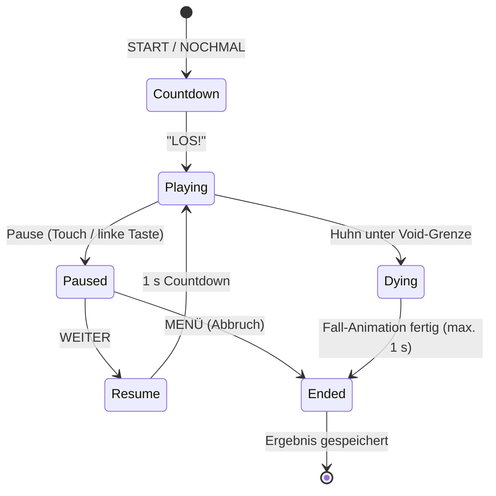

# 05 – Gameplay-Regeln

Alle Längen in **logischen Pixeln (px)** der Spielwelt (siehe [08](08-grafik-pixel-art.md):
logische Auflösung 155 × 155, 1 px logisch = 3 × 3 px physisch). Zeiten in Sekunden (s).
y-Achse zeigt **nach unten**. Alle `K_*`-Werte sind zentrale Tuning-Konstanten.

## 5.1 Spielprinzip

- Seitwärts scrollendes Jump'n'Run, Bewegung **nur nach rechts** (kein Rückwärtslaufen).
- **Kein Auto-Scroll:** Die Welt bewegt sich nur, wenn das Huhn sich bewegt. Zeitdruck entsteht
  ausschließlich durch brüchige Brücken.
- Ein Run endet nur durch Fall ins Void oder Abbruch über das Pausenmenü.

## 5.2 Eingabezustände (aus dem Mikrofon, Details in [07](07-audio-und-mikrofon.md))

| Zustand | Bedeutung | Zusatzwert |
|---------|-----------|------------|
| `STILL` | Pegel unter Reden-Schwelle | – |
| `TALK` | Pegel zwischen Reden- und Schrei-Schwelle | `intensity` ∈ [0,1] (0 = an Reden-Schwelle, 1 = an Schrei-Schwelle) |
| `SHOUT` | Pegel ≥ Schrei-Schwelle | – |

## 5.3 Bewegung & Physik

### Tuning-Konstanten (Startwerte)

| Konstante | Wert | Beschreibung |
|-----------|------|--------------|
| `K_GRAVITY` | 600 px/s² | Schwerkraft |
| `K_MAX_FALL` | 260 px/s | Maximale Fallgeschwindigkeit |
| `K_WALK_MIN` | 35 px/s | Laufgeschwindigkeit bei `intensity` = 0 |
| `K_WALK_MAX` | 60 px/s | Laufgeschwindigkeit bei `intensity` = 1 |
| `K_GROUND_ACCEL` | 400 px/s² | Beschleunigung am Boden |
| `K_GROUND_DECEL` | 600 px/s² | Abbremsen am Boden (bei `STILL`) |
| `K_JUMP_VY` | 200 px/s | Absprunggeschwindigkeit nach oben |
| `K_AIR_VX` | 70 px/s | Horizontalgeschwindigkeit in der Luft ohne Flattern |
| `K_FLAP_VX` | 85 px/s | Horizontalgeschwindigkeit beim Flattern |
| `K_FLAP_MAX_FALL` | 35 px/s | Max. Sinkgeschwindigkeit beim Flattern |
| `K_FLAP_STAMINA` | 0,8 s | Flatter-Ausdauer pro Luftphase |
| `K_COYOTE` | 0,08 s | Nach Verlassen einer Kante darf noch gesprungen werden |
| `K_PHYS_DT` | 1/60 s | Fester Physik-Zeitschritt (Simulation unabhängig von der Framerate) |

Abgeleitete Referenzwerte (bei Änderung der Konstanten neu berechnen):
Sprunghöhe ≈ 33 px, Luftzeit ≈ 0,67 s, Sprungweite ohne Flattern ≈ 47 px,
maximale Weite mit Dauer-Schrei ≈ 100 px (gleiche Höhe).

### Regeln

| ID | Regel |
|----|-------|
| FR-GP-01 | **Am Boden, `STILL`:** horizontale Geschwindigkeit wird mit `K_GROUND_DECEL` auf 0 reduziert. Animation: *Idle*. |
| FR-GP-02 | **Am Boden, `TALK`:** Zielgeschwindigkeit = `K_WALK_MIN + intensity × (K_WALK_MAX − K_WALK_MIN)`; Annäherung mit `K_GROUND_ACCEL` bzw. `K_GROUND_DECEL`. Animation: *Walk* (Animationstempo proportional zur Geschwindigkeit). |
| FR-GP-03 | Bei `STILL` MUSS das Huhn innerhalb von ≤ 150 ms (inkl. Mikrofon-Glättung) stehen. |
| FR-GP-10 | **Sprung:** Ist das Huhn am Boden (oder innerhalb `K_COYOTE` nach Verlassen einer Kante) und der Zustand ist `SHOUT`, springt es: `vy = −K_JUMP_VY`, `vx = K_AIR_VX`. Auch ein **gehaltener** Schrei löst nach der Landung sofort den nächsten Sprung aus. |
| FR-GP-11 | **Luftphase ohne Flattern:** `vx` bleibt `K_AIR_VX` (bzw. bei Fall von einer Kante die aktuelle Laufgeschwindigkeit); Schwerkraft wirkt normal; keine Luftsteuerung durch `TALK`/`STILL`. |
| FR-GP-12 | **Flattern:** In der Luft, Zustand `SHOUT`, Ausdauer > 0: `vx = K_FLAP_VX`; falls `vy > K_FLAP_MAX_FALL` (sinkend), wird `vy` auf `K_FLAP_MAX_FALL` begrenzt. Animation: *Flap* (schneller Flügelschlag). |
| FR-GP-13 | **Ausdauer** wird nur verbraucht, während geflattert wird **und** das Huhn sinkt (`vy ≥ 0`). Beim Steigen wird keine Ausdauer verbraucht. Bei Landung wird die Ausdauer auf `K_FLAP_STAMINA` zurückgesetzt. |
| FR-GP-14 | Ist die Ausdauer leer, verhält sich das Huhn wie FR-GP-11 (bei `vx = K_AIR_VX`). Die Ausdauer wird dezent visualisiert (z. B. kleiner Balken über dem Huhn, nur während der Luftphase sichtbar). |
| FR-GP-15 | Am Boden ausgelöstes Flattern gibt es nicht – `SHOUT` am Boden ist immer Sprung. |
| FR-GP-20 | **Kollision:** Achsen-getrennte AABB-Kollision (erst x, dann y) zwischen Huhn-Hitbox und festen Elementen (Inseln, intakte Brückensegmente, Hindernisse). |
| FR-GP-21 | **Seitliche Kollision:** Huhn wird an der Kante gestoppt (`vx = 0`), stirbt nicht. In der Luft fällt es danach senkrecht weiter. |
| FR-GP-22 | **Kopfkollision:** Stößt das Huhn von unten an, wird `vy = 0` gesetzt. |
| FR-GP-23 | **Huhn-Hitbox:** 10 × 13 px, horizontal zentriert im 16 × 16-Sprite, bündig mit dessen Unterkante. |
| FR-GP-24 | Das Huhn kann auf Hindernissen und auf höheren Inseln stehen (Oberseite ist begehbar). Es gibt **kein** automatisches Hochsteigen von Stufen – jede Erhöhung > 0 px wirkt wie eine Wand. |
| FR-GP-30 | **Tod:** Liegt die Oberkante der Hitbox unterhalb von y = 155 (unterer Rand der logischen Fläche), endet der Run → UC-09. |
| FR-GP-31 | Während der Fall-Animation nach dem Tod (bis zum Game-Over-Screen, max. 1 s) werden Eingaben ignoriert. |

## 5.4 Kamera

| ID | Regel |
|----|-------|
| FR-GP-35 | Die Kamera folgt horizontal so, dass das Huhn bei x = 50 px (Bildschirmkoordinate) steht. Kamera bewegt sich nie zurück. |
| FR-GP-36 | Vertikal ist die Kamera fix; die Welt passt vertikal komplett in den Bildschirm. |
| FR-GP-37 | Weltkoordinaten MÜSSEN bis mindestens 1.000.000 px (125 km) ohne Präzisionsprobleme funktionieren (z. B. Ganzzahl-/Festkomma- oder relative Koordinaten). |

## 5.5 Map-Elemente

Kachelraster: **8 px**. Alle Elemente sind auf ganze Kacheln ausgerichtet (Ausnahme: Coins).

### Bodenniveaus

| Konstante | y (Oberkante) | Verfügbar ab Stufe |
|-----------|---------------|--------------------|
| `K_LEVEL_0` | 104 | 1 |
| `K_LEVEL_UP1` / `K_LEVEL_DOWN1` | 96 / 112 | 2 |
| `K_LEVEL_UP2` / `K_LEVEL_DOWN2` | 88 / 120 | 3 |

### Inseln (FR-MP-01 … 05)

| ID | Regel |
|----|-------|
| FR-MP-01 | Insel = fester, rechteckiger Kollisionsbereich mit Breite 24–120 px (Vielfaches von 8), Oberkante auf einem Bodenniveau, optisch nach unten verjüngend (schwebende Insel, Grasdecke oben). Kollisionsmäßig reicht sie bis zum unteren Bildrand. |
| FR-MP-02 | Zwischen Inseln liegen **Lücken** (Void). Lückenbreite siehe Generator-Regeln. |
| FR-MP-03 | Die **Startinsel** ist 96 px breit auf `K_LEVEL_0`, ohne Hindernisse; das Huhn startet bei x = 24 px auf ihr. |

### Brüchige Brücken (FR-MP-10 … 16)

| ID | Regel |
|----|-------|
| FR-MP-10 | Eine Brücke überspannt eine Lücke zwischen zwei Inseln **gleichen Niveaus** und besteht aus 3–8 Segmenten à 8 px Breite, 4 px Dicke (Holzplanken), Oberkante bündig mit dem Niveau. |
| FR-MP-11 | Jedes Segment hat eine Stabilität `K_BRIDGE_STABILITY` = **0,7 s**. Sie sinkt nur, solange die Huhn-Hitbox auf dem Segment **steht** (am Boden, mit horizontaler Überlappung). |
| FR-MP-12 | Unterschreitet die Restzeit `K_BRIDGE_SHAKE` = **0,35 s**, wackelt das Segment sichtbar (±1 px horizontal, Knister-Partikel optional). |
| FR-MP-13 | Bei Restzeit 0 bricht das Segment: es ist sofort nicht mehr fest und fällt animiert (≈ 0,5 s) nach unten aus dem Bild. |
| FR-MP-14 | Die Stabilität regeneriert sich nicht. Eingestürzte Segmente kehren nicht zurück. |
| FR-MP-15 | Steht das Huhn über zwei Segmenten, sinkt die Stabilität beider. |
| FR-MP-16 | Mit `K_WALK_MIN` MUSS jedes Segment ohne Einsturz unter dem Huhn überquerbar sein: `(8 + Hitbox-Breite) / K_WALK_MIN < K_BRIDGE_STABILITY` (aktuell 0,51 s < 0,7 s). Bei Änderung der Konstanten ist diese Bedingung per Unit-Test abzusichern. |

### Hindernisse (FR-MP-20 … 23)

| ID | Typ | Größe (B × H) | Optik | ab Stufe |
|----|-----|---------------|-------|----------|
| FR-MP-20 | Heuballen | 8 × 8 | gelb, Strohstruktur | 1 |
| FR-MP-21 | Holzzaun | 8 × 16 | braune Latten | 2 |
| FR-MP-22 | Steinblock | 16 × 16 | grauer Stein | 2 |
| FR-MP-23 | Hoher Turm (2 gestapelte Heuballen + Kiste) | 8 × 24 | gestapelt | 3 |

- Hindernisse stehen auf Inseln (ab Stufe 3 auch auf Brücken, dann zählen sie als fest und brechen mit dem Segment ein, auf dem sie stehen).
- Sie blockieren seitlich, sind von oben begehbar und töten nie (FR-GP-21).
- Vor und hinter jedem Hindernis MÜSSEN mindestens 16 px freier Boden auf gleicher Höhe liegen (Anlauf / Landung).

### Coins (FR-MP-25 … 27)

| ID | Regel |
|----|-------|
| FR-MP-25 | Coin: 8 × 8 px Sprite, Hitbox 6 × 6 px (zentriert), Wert 1, rotierende Animation (4 Frames). Coins schweben (±1 px Sinus, rein optisch, Hitbox fix). |
| FR-MP-26 | Platzierungsmuster: (a) **Reihe** 3–5 Coins im Abstand 12 px, 8 px über dem Boden; (b) **Bogen** 3–5 Coins entlang der Referenz-Sprungbahn über einer Lücke/einem Hindernis; (c) **Flatter-Reihe** 3–4 Coins entlang der Referenz-Flatterbahn (nur über großen Lücken, Stufe 3). |
| FR-MP-27 | Jeder Coin MUSS auf einer mit den Bewegungsregeln erreichbaren Position liegen (siehe FR-MP-36). Ziel-Dichte: im Mittel 1 Coin pro 8–12 m. |

## 5.6 Map-Generator

| ID | Regel |
|----|-------|
| FR-MP-30 | Die Map ist **endlos** und wird zur Laufzeit aus **Chunks** (Bausteinen) zusammengesetzt. Jeder Run nutzt einen neuen Zufalls-Seed. Bei gleichem Seed MUSS die Map identisch sein (deterministisch, testbar). |
| FR-MP-31 | Es MÜSSEN stets mindestens 320 px Welt rechts vom Kamera-Rand generiert sein. Elemente links außerhalb der Kamera (− 32 px) dürfen verworfen werden. Der Speicherverbrauch darf über die Run-Länge nicht wachsen. |
| FR-MP-32 | **Schwierigkeitsstufen nach Score:** Stufe 1: 0–99 m; Stufe 2: 100–299 m; Stufe 3: ≥ 300 m. Maßgeblich ist die Position, an der der Chunk generiert wird. |
| FR-MP-33 | Nach jedem Herausforderungs-Chunk folgt eine **Landezone**: mind. 24 px flacher Boden ohne Hindernis. |
| FR-MP-34 | Niveauwechsel zwischen benachbarten Inseln: max. ±8 px (Stufe 2) bzw. ±16 px (Stufe 3); aufwärts nur über eine Lücke oder als Stufe (Stufe wirkt als Hindernis der entsprechenden Höhe). |
| FR-MP-35 | Kein Chunk-Typ darf mehr als 2× direkt hintereinander vorkommen. |
| FR-MP-36 | **Lösbarkeitsgarantie:** Für jede Lücke und jedes Hindernis prüft der Generator mit einer Referenzsimulation (gleiche Physik wie im Spiel, Absprung an der Kante): Lücken der Klasse "ohne Flattern" ≤ 85 % der simulierten Weite ohne Flattern; Lücken der Klasse "mit Flattern" ≤ 80 % der simulierten Weite mit Dauer-Schrei – jeweils unter Berücksichtigung des Höhenunterschieds. Die Lückenbreite wird ohne Abzug der Hitbox-Breite gemessen (konservativ). Hindernisse müssen per Sprung (Stufe 1–2) bzw. Sprung+Flattern (Stufe 3) überwindbar oder bestehbar sein. |
| FR-MP-37 | Wahrscheinlichkeiten der Chunk-Typen sind je Stufe gewichtet (Tabelle unten). Gewichte sind Tuning-Konstanten. |

### Chunk-Katalog

| Chunk | Beschreibung | Parameter | Gewicht S1 | S2 | S3 |
|-------|--------------|-----------|-----------:|---:|---:|
| `FLAT` | Insel ohne Herausforderung, ggf. Coin-Reihe | Breite 40–96 | 4 | 2 | 1 |
| `GAP_S` | Kleine Lücke | 16–24 px | 4 | 2 | 1 |
| `GAP_M` | Mittlere Lücke, präziser Sprung | 32–40 px | 0 | 3 | 2 |
| `GAP_L` | Große Lücke, Flattern nötig | 48–80 px (begrenzt durch FR-MP-36) | 0 | 1 | 3 |
| `OBST_LOW` | Heuballen auf Insel | 1–2 Heuballen, Abstand ≥ 24 px | 3 | 2 | 1 |
| `OBST_HIGH` | Zaun oder Steinblock | – | 0 | 3 | 2 |
| `OBST_TOWER` | Hoher Turm | – | 0 | 0 | 2 |
| `BRIDGE_S` | Kurze Brücke | 3–4 Segmente | 3 | 2 | 1 |
| `BRIDGE_L` | Lange Brücke | 5–8 Segmente | 0 | 2 | 3 |
| `STEP` | Niveauwechsel per Lücke (16–24 px) auf/ab | ±8 / ±16 | 0 | 2 | 2 |
| `COMBO_OG` | Hindernis direkt (16 px) vor einer Lücke `GAP_S` | – | 0 | 0 | 2 |
| `COMBO_BO` | Brücke mit Heuballen auf einem mittleren Segment | 5–7 Segmente | 0 | 0 | 2 |

## 5.7 Score & Coins im Run

| ID | Regel |
|----|-------|
| FR-GP-40 | **Score (Meter)** = `floor((x_max − x_start) / 8)`, wobei `x_max` die weiteste je erreichte x-Position des Huhns ist. Der Score sinkt nie. Anzeige ganzzahlig, max. 6 Stellen. |
| FR-GP-41 | Der Highscore wird nur am Ende eines Runs aktualisiert (UC-09a); im HUD wird während des Runs bei Überschreiten des Highscores der Score einmalig kurz hervorgehoben (Farbwechsel Gold für 1 s). |
| FR-GP-50 | **Run-Coins** starten bei 0 und erhöhen sich pro eingesammeltem Coin um 1. |
| FR-GP-51 | Run-Coins werden am Run-Ende (Tod **und** Abbruch) vollständig dem Gesamtguthaben gutgeschrieben. Bei Stromausfall während eines Runs gehen nur die Run-Coins dieses Runs verloren. |

## 5.8 Run-Ablauf (Zustände)

