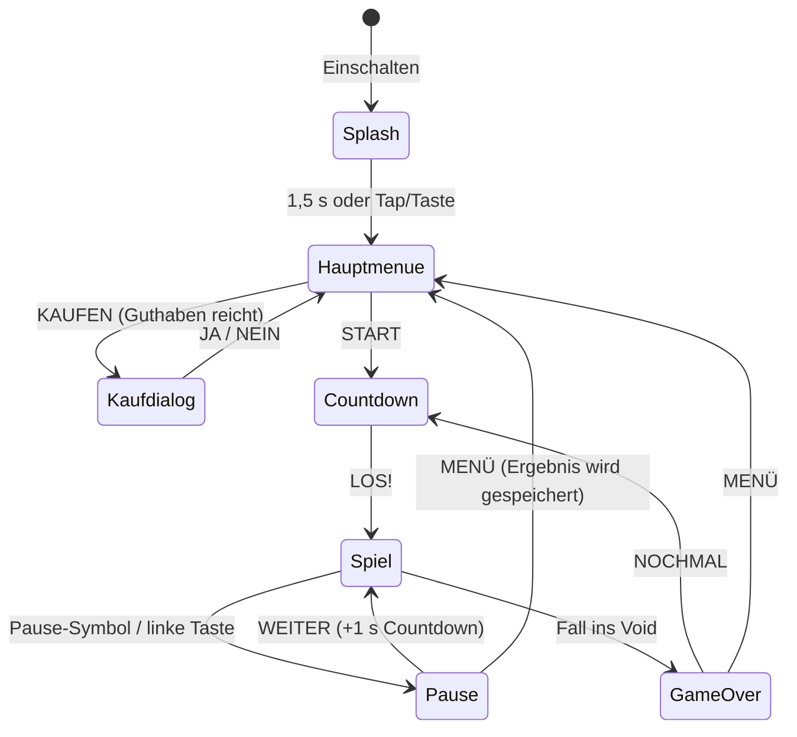

# 06 – Screens & Bedienung

## 6.1 Grundprinzipien

| ID | Prinzip |
|----|---------|
| FR-UI-P1 | **Rundes Display:** Alle bedienbaren und lesbaren Inhalte MÜSSEN innerhalb des Safe-Kreises liegen: Mittelpunkt (77, 77), Radius **72** logische px. Hintergrund/Welt darf bis zum Rand gezeichnet werden. |
| FR-UI-P2 | **Links ↔ links:** Eine Bildschirm-Aktion auf der linken Seite entspricht immer der **linken** Taste, rechts der **rechten** Taste. Die Tastenzuordnung wird im UI nicht extra erklärt, ergibt sich aber aus der Position. |
| FR-UI-P3 | **Touch-Ziele** sind mindestens 24 × 20 logische px groß (≈ 7 × 6 mm). Die Trefferfläche darf größer als die Grafik sein. |
| FR-UI-P4 | **Tap** = Berühren + Loslassen innerhalb von 500 ms mit Bewegung < 10 logischen px; die Aktion wird beim **Loslassen** ausgelöst, wenn der Loslasspunkt in derselben Trefferfläche liegt. |
| FR-UI-P5 | **Tasten:** Kurzer Druck (< 600 ms) löst beim Loslassen aus. **Langer Druck** löst aus, sobald 600 ms erreicht sind (`K_LONGPRESS_MS`), nicht erst beim Loslassen; danach erzeugt dasselbe Loslassen kein Kurzdruck-Event. |
| FR-UI-P6 | Gedrückte Buttons zeigen visuelles Feedback (invertiert/abgedunkelt) während des Drucks. Menü-Navigation erzeugt einen kurzen Klick-Ton (wenn Ton an). |
| FR-UI-P7 | Nach jedem Screenwechsel werden Eingaben für 250 ms ignoriert (Ausnahme: Game Over 1000 ms). Eine beim Wechsel noch gehaltene Taste/Berührung löst nichts aus. |
| FR-UI-P8 | Texte: Deutsch, Großbuchstaben für Buttons. Umlaute nur, wenn die verwendete Pixel-Schrift sie darstellt – sonst Ersatz (`MENUE`, `FUER`). |
| FR-UI-P9 | Die Power-Taste wird von der Firmware nicht belegt (Geräte-Standardverhalten). |

## 6.2 Screen-Flow



## 6.3 Screens im Detail

Koordinaten: logische px (0–154), Werte sind Richtwerte (±4 px), Safe-Kreis hat Vorrang.

### S1 – Splash (FR-UI-01 … 03)

| Element | Position | Inhalt |
|---------|----------|--------|
| Titel | zentriert, y ≈ 40 | `SCHREIHUHN` (große Pixel-Schrift, 2× Schriftgröße) |
| Huhn | zentriert, y ≈ 62–94 | Standard-Huhn 2× skaliert, läuft auf der Stelle |
| Hinweis | zentriert, y ≈ 108–124 | `REDEN = LAUFEN` / `SCHREIEN = SPRINGEN` (zweizeilig) |

- FR-UI-01: Anzeige 1,5 s, dann Hauptmenü. Tap/Taste überspringt.
- FR-UI-02: Start-Jingle beim Splash (wenn Ton an).
- FR-UI-03: Bei Initialisierungsfehler Mikrofon zusätzlich rote Zeile `MIKROFON-FEHLER` (y ≈ 130).

### S2 – Hauptmenü (FR-UI-10 … 16)

```
            ( ●  1.234 )          ← Coin-Guthaben, y≈14–24
              HI 312 m            ← Highscore, y≈28–36
                                  
     ◀        [ HUHN ]        ▶   ← Pfeile x≈22 / x≈132, Huhn 3× skaliert, Mitte (77,70)
                                  
             GOLDIE               ← Name, y≈98
            🔒 50  /  GEWÄHLT     ← Status, y≈106
                                  
           [   START   ]          ← Aktions-Button, y≈112–132, Breite ≈ 70
               🔊                 ← Ton-Symbol, y≈138–150
```

| ID | Element | Verhalten | Touch | Taste |
|----|---------|-----------|-------|-------|
| FR-UI-10 | Coin-Guthaben | Coin-Icon + Zahl mit Tausenderpunkt | – | – |
| FR-UI-11 | Highscore | `HI <n> m` | – | – |
| FR-UI-12 | Pfeil ◀ / ▶ | vorheriges / nächstes Huhn (zyklisch), Huhn gleitet/blinkt kurz beim Wechsel | Tap auf Pfeil (Trefferfläche ≈ 28 × 40) | linke / rechte Taste kurz |
| FR-UI-13 | Huhn-Vorschau | Idle-Animation; gesperrte Hühner als dunkle Silhouette mit Schloss | – | – |
| FR-UI-14 | Status | freigeschaltet + gewählt: `GEWÄHLT`; freigeschaltet: leer; gesperrt: Schloss + Preis | – | – |
| FR-UI-15 | Aktions-Button | freigeschaltet: `START` (→ Countdown); gesperrt & Guthaben reicht: `KAUFEN <Preis>` (→ Kaufdialog); gesperrt & Guthaben reicht nicht: ausgegraut `FEHLEN <n>` (→ Fehler-Ton + Button wackelt) | Tap | rechte Taste lang |
| FR-UI-16 | Ton-Symbol | Lautsprecher, durchgestrichen wenn aus; schaltet um | Tap (Trefferfläche ≈ 24 × 20) | linke Taste lang |

### S3 – Kaufdialog (FR-UI-20 … 21)

Modales Overlay über dem abgedunkelten Hauptmenü.

| Element | Inhalt | Touch | Taste |
|---------|--------|-------|-------|
| Text | `<NAME>` / `FÜR ● <Preis> KAUFEN?` | – | – |
| Button links | `NEIN` | Tap | linke Taste kurz |
| Button rechts | `JA` | Tap | rechte Taste kurz |
| Außerhalb tippen | = `NEIN` | Tap | – |

- FR-UI-21: Nach `JA` → Kauf (UC-04), Rückkehr ins Menü mit dem gekauften Huhn, Button zeigt `START`.

### S4 – Countdown / Kalibrierung (FR-UI-25 … 27)

- Hintergrund: Spielwelt mit Huhn auf der Startinsel (eingefroren).
- FR-UI-25: Großer Countdown `3`, `2`, `1` (je 500 ms, insgesamt = `K_CALIB_MS` = 1500 ms), darunter `PSST... LEISE!`.
- FR-UI-26: Danach `LOS!` für 500 ms; Steuerung ist ab Erscheinen von `LOS!` aktiv.
- FR-UI-27: Während des Countdowns werden **keine** Sounds abgespielt; Tasten/Touch werden ignoriert (kein Abbruch möglich).
- Beim Fortsetzen nach Pause: nur `1` (1000 ms) ohne neue Kalibrierung, kein `PSST`.

### S5 – Spiel / HUD (FR-UI-30 … 33)

| ID | Element | Position | Inhalt |
|----|---------|----------|--------|
| FR-UI-30 | Score | oben zentriert, y ≈ 10–24 | `<n>` groß + kleines `m` |
| FR-UI-31 | Pegelbalken (SOLL) | unten zentriert, y ≈ 138–143, Breite ≈ 50 | Füllstand = aktueller Pegel; Bereiche grau / grün / rot; zwei Markierungsstriche an den Schwellen |
| FR-UI-32 | Run-Coins | rechts oben, ≈ (104–130, 28–36) | Coin-Icon + Zahl |
| FR-UI-33 | Pause-Symbol | links oben, ≈ (28–40, 26–36), Trefferfläche ≈ 30 × 24 | `❚❚`; Tap → Pause. Zusätzlich: linke Taste kurz → Pause. Rechte Taste hat im Spiel keine Funktion (außer im `SIM_INPUT`-Modus). |

- Der Rest des Touchscreens hat im Spiel **keine** Funktion (verhindert versehentliche Pausen).
- HUD-Elemente haben einen 1-px-Outline in Dunkel für Lesbarkeit vor jedem Hintergrund.

### S6 – Pause (FR-UI-35 … 36)

- Abgedunkeltes Overlay (Dither-Muster oder 50 % Abdunklung) über eingefrorener Welt.
- Titel `PAUSE`, darunter Score.
- FR-UI-35: Button links `MENÜ` (Tap / linke Taste kurz) → Run regulär beenden, direkt Hauptmenü.
- FR-UI-36: Button rechts `WEITER` (Tap / rechte Taste kurz) → 1 s Countdown → Spiel.

### S7 – Game Over (FR-UI-40 … 43)

| Element | Position | Inhalt |
|---------|----------|--------|
| Titel | y ≈ 28 | `GAME OVER` |
| Neuer Highscore | y ≈ 44 | `NEUER HIGHSCORE!` blinkend in Gold (nur wenn zutreffend) |
| Score | y ≈ 60 | `<n> m` groß |
| Run-Coins | y ≈ 80 | `+● <n>` |
| Gesamt | y ≈ 92 | `GESAMT ● <n>` |
| Button links | y ≈ 108–128 | `MENÜ` |
| Button rechts | y ≈ 108–128 | `NOCHMAL` |

- FR-UI-40: Eingaben werden 1000 ms nach Erscheinen ignoriert; Buttons erscheinen erst danach (oder ausgegraut).
- FR-UI-41: `NOCHMAL` (Tap / rechte Taste kurz) → Countdown mit neuem Seed, gleiches Huhn.
- FR-UI-42: `MENÜ` (Tap / linke Taste kurz) → Hauptmenü.
- FR-UI-43: Daten sind beim Erscheinen dieses Screens bereits gespeichert (UC-09a).

## 6.4 Steuerungs-Matrix (Übersicht)

| Screen | Linke Taste kurz | Linke Taste lang | Rechte Taste kurz | Rechte Taste lang | Touch |
|--------|------------------|------------------|-------------------|-------------------|-------|
| Splash | weiter | weiter | weiter | weiter | Tap überall: weiter |
| Hauptmenü | Huhn zurück | Ton an/aus | Huhn vor | Aktion (START/KAUFEN) | Pfeile, Aktions-Button, Ton-Symbol |
| Kaufdialog | NEIN | – | JA | – | NEIN, JA, außerhalb = NEIN |
| Countdown | – | – | – | – | – |
| Spiel | Pause | – | – | – | Pause-Symbol |
| Pause | MENÜ | – | WEITER | – | MENÜ, WEITER |
| Game Over | MENÜ | – | NOCHMAL | – | MENÜ, NOCHMAL |
| Spiel (`SIM_INPUT`) | halten = TALK | – | halten = SHOUT | – | Pause-Symbol |

## 6.5 UI-Texte (verbindlich)

| Schlüssel | Text |
|-----------|------|
| title | `SCHREIHUHN` |
| hint_1 / hint_2 | `REDEN = LAUFEN` / `SCHREIEN = SPRINGEN` |
| hiscore | `HI {n} m` |
| btn_start | `START` |
| btn_buy | `KAUFEN {p}` |
| btn_missing | `FEHLEN {n}` |
| status_selected | `GEWÄHLT` |
| dlg_buy | `FÜR {p} KAUFEN?` |
| btn_yes / btn_no | `JA` / `NEIN` |
| countdown_quiet | `PSST... LEISE!` |
| go | `LOS!` |
| pause | `PAUSE` |
| btn_resume / btn_menu | `WEITER` / `MENÜ` |
| game_over | `GAME OVER` |
| new_hiscore | `NEUER HIGHSCORE!` |
| total | `GESAMT {n}` |
| btn_retry | `NOCHMAL` |
| err_mic | `MIKROFON-FEHLER` |
